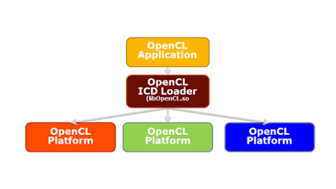

# openCL使用3种计算资源（CPU，核显，N卡GPU）处理YUV转RGB
**概述:**  基于 OpenCL 构建异构图像处理模块，统一调度 Intel CPU、集成显卡及 NVIDIA GPU 三种计算资源，实现 YUV 到 RGB 的并行转换与硬件加速，提升图像预处理效率。

围绕 OpenCL 多设备异构计算开展实践，搭建 Intel CPU、Intel 集成显卡及 NVIDIA GPU 三种计算资源的开发与运行环境，完成驱动、Runtime、开发工具链配置。通过 C++ 编程实现多设备枚举、资源选择、Kernel 编写与任务调度，并以 YUV 转 RGB 为实例，验证不同计算设备的并行计算能力及性能差异。

## 环境配置
### 安装intel oneMKL
按照官网的方式安装：https://www.intel.com/content/www/us/en/developer/tools/oneapi/onemkl-download.html?operatingsystem=linux&linux-install=apt

安装后通过命令查看
```bash
ls -l /etc/OpenCL/vendors/
```
得到：intel64.icd，这个是指向Intel CPU 的libintelocl.so

### 安装intel的intel-graphics
按照官网方式安装：https://dgpu-docs.intel.com/legacy/installation-guides/installing-packages-from-the-intel-ppa.html

安装后通过命令查看
```bash
ls -l /etc/OpenCL/vendors/
```
得到：intel.icd，这个是指向Intel 显卡的libigdrcl.so

### 安装nvidia显卡
这个也可以参照官网安装，这里不做详细描述
安装后通过命令查看
```bash
ls -l /etc/OpenCL/vendors/
```
得到：intel64.icd，这个是指向nvidia 显卡的libnvidia-opencl.so.1


## openCL执行图：ICD Loader 架构
当在编译命令中写 -lOpenCL 时，连接器（ld）寻找的是libOpenCL.so，这个 libOpenCL.so 是一个通用中介代理（ICD Loader），它只提供标准的 OpenCL API 导出符号（如 clCreateContext、clEnqueueNDRangeKernel 等），本身不包含任何显卡硬件的执行代码。/etc/OpenCL/vendors/ 目录下放置的只是纯文本配置文件（扩展名为 .icd），里面记录了真正的硬件驱动库路径（如 /usr/lib/x86_64-linux-gnu/intel-opencl/libigdrcl.so）。当编译好的程序开始运行并调用第一个 OpenCL API 时，ICD Loader (libOpenCL.so) 才会去读取 /etc/OpenCL/vendors/ 目录下的 .icd 文件，根据文件里的路径使用 dlopen() 动态加载真实的 GPU 厂商驱动库。




## 运行代码
先查看openCL的设备信息，使用命令：clinfo -l得到如下：
```
Platform #0: Intel(R) OpenCL
 `-- Device #0: 11th Gen Intel(R) Core(TM) i9-11950H @ 2.60GHz
Platform #1: Intel(R) OpenCL Graphics (integrated)
 `-- Device #0: Intel(R) UHD Graphics
Platform #2: NVIDIA CUDA
 `-- Device #0: NVIDIA RTX A2000 Laptop GPU
 ```

代码如下：
```cpp

#include <iostream>
#include <fstream>
#include <vector>
#include <CL/cl2.hpp>
#include <opencv2/opencv.hpp>

#define WORKGROUP_SIZE 16
typedef unsigned char uchar;

const char* kernelSource = R"(
__kernel void yuv420_to_rgb(__global uchar* y_plane, 
                           __global uchar* u_plane,
                           __global uchar* v_plane,
                           __global uchar* rgb_output,
                           int width, int height) {
    int x = get_global_id(0);
    int y = get_global_id(1);
    
    if (x >= width || y >= height) return;
    
    int uv_x = x / 2;
    int uv_y = y / 2;
    int uv_offset = uv_y * (width/2) + uv_x;
    
    uchar Y = y_plane[y * width + x];
    uchar U = u_plane[uv_offset];
    uchar V = v_plane[uv_offset];
    
    // YUV to RGB conversion
    int R = Y + 1.402 * (V - 128);
    int G = Y - 0.344136 * (U - 128) - 0.714136 * (V - 128);
    int B = Y + 1.772 * (U - 128);
    
    // Clamp values
    R = min(max(R, 0), 255);
    G = min(max(G, 0), 255);
    B = min(max(B, 0), 255);
    
    int rgb_offset = (y * width + x) * 3;
    rgb_output[rgb_offset]     = (uchar)B;
    rgb_output[rgb_offset + 1] = (uchar)G;
    rgb_output[rgb_offset + 2] = (uchar)R;
}
)";

int main(int argc, char** argv) {
    if (argc != 3) {
        std::cerr << "Usage: " << argv[0] << " <input.yuv> <output.jpg>" << std::endl;
        return 1;
    }

    const char* input_file = argv[1];
    const char* output_file = argv[2];
    const int width = 4682;  // 修改为实际分辨率
    const int height = 5852; // 修改为实际分辨率

    // 1. 读取YUV文件
    std::ifstream yuv_file(input_file, std::ios::binary);
    if (!yuv_file) {
        std::cerr << "Error opening YUV file" << std::endl;
        return 1;
    }

    size_t yuv_size = width * height * 3 / 2;
    std::vector<uchar> yuv_data(yuv_size);
    yuv_file.read(reinterpret_cast<char*>(yuv_data.data()), yuv_size);
    yuv_file.close();
    std::cout << "YUV SIZE: " << yuv_data.size() << std::endl;

    // 2. 初始化OpenCL
    std::vector<cl::Platform> platforms;
    cl::Platform::get(&platforms);
    if (platforms.empty()) {
        std::cerr << "No OpenCL platforms found" << std::endl;
        return 1;
    }

    // 打印所有的平台
    for (const auto &platform : platforms)
    {
        std::cout << "平台：" << platform.getInfo<CL_PLATFORM_NAME>() << std::endl;
    }

    cl::Platform platform = platforms[2];//这里选取哪个平台，对应clinfo -l显示的
    std::cout << "使用平台: " << platform.getInfo<CL_PLATFORM_NAME>() << std::endl;

    std::vector<cl::Device> devices;
    
    // platform.getDevices(CL_DEVICE_TYPE_GPU, &devices);
    platform.getDevices(CL_DEVICE_TYPE_DEFAULT, &devices);//使用默认的可匹配CPU，GPU
    if (devices.empty()) {
        std::cerr << "No GPU devices found" << std::endl;
        return 1;
    }

    cl::Device device = devices[0];
    std::cout << "使用设备: " << device.getInfo<CL_DEVICE_NAME>() << std::endl;

    cl::Context context(device);
    cl::CommandQueue queue(context, device);

    // 3. 编译内核
    cl::Program program(context, kernelSource);
    try {
        program.build({device});
    } catch (...) {
        std::string build_log = program.getBuildInfo<CL_PROGRAM_BUILD_LOG>(device);
        std::cerr << "Build log:\n" << build_log << std::endl;
        return 1;
    }

    // 4. 准备内存对象
    size_t y_size = width * height;
    size_t uv_size = width * height / 4;
    
    cl::Buffer y_buf(context, CL_MEM_READ_ONLY, y_size);
    cl::Buffer u_buf(context, CL_MEM_READ_ONLY, uv_size);
    cl::Buffer v_buf(context, CL_MEM_READ_ONLY, uv_size);
    cl::Buffer rgb_buf(context, CL_MEM_WRITE_ONLY, width * height * 3);

    // 5. 分离YUV分量
    uchar* y_plane = yuv_data.data();
    uchar* u_plane = y_plane + y_size;
    uchar* v_plane = u_plane + uv_size;

    // check uv format
    //uuuuu...vvvv
    if(yuv_data[y_size] == yuv_data[y_size+1] && yuv_data[y_size+2] == yuv_data[y_size+3])
    {
        std::cout << "FORMAT YUV420P" << std::endl;
    }
    //uvuv
    else if (yuv_data[y_size] != yuv_data[y_size+1] && yuv_data[y_size] == yuv_data[y_size+2])
    {
        std::cout << "FORMAT NV12/21" << std::endl;
    }
    else
    {
        std::cout << "FORMAT UNKNOWN" << std::endl;
    }

    queue.enqueueWriteBuffer(y_buf, CL_TRUE, 0, y_size, y_plane);
    queue.enqueueWriteBuffer(u_buf, CL_TRUE, 0, uv_size, u_plane);
    queue.enqueueWriteBuffer(v_buf, CL_TRUE, 0, uv_size, v_plane);

    // 6. 执行内核
    cl::Kernel kernel(program, "yuv420_to_rgb");
    kernel.setArg(0, y_buf);
    kernel.setArg(1, u_buf);
    kernel.setArg(2, v_buf);
    kernel.setArg(3, rgb_buf);
    kernel.setArg(4, width);
    kernel.setArg(5, height);

    cl::NDRange global_size(width, height);
    queue.enqueueNDRangeKernel(kernel, cl::NullRange, global_size, cl::NullRange);
    queue.finish();

    // 7. 读取结果并保存为JPG
    std::vector<uchar> rgb_data(width * height * 3);
    queue.enqueueReadBuffer(rgb_buf, CL_TRUE, 0, rgb_data.size(), rgb_data.data());

    cv::Mat rgb_img(height, width, CV_8UC3, rgb_data.data());
    std::vector<int> params;
    params.push_back(cv::IMWRITE_JPEG_QUALITY);
    params.push_back(95);
    cv::imwrite(output_file, rgb_img, params);
    
    std::cout << "Conversion completed: " << output_file << std::endl;
    return 0;
}
```

编译命令：
```
g++ yuv2rgb2.cpp -o yuv2rgb2 -I/usr/include/opencv4 -lopencv_core -lopencv_imgcodecs  -lopencv_imgproc -lOpenCL
```

执行命令和结果：
```
./yuv2rgb2 frank.yuv frank_nvidia-gpu.jpg

YUV SIZE: 41098596
平台：Intel(R) OpenCL
平台：Intel(R) OpenCL Graphics (integrated)
平台：NVIDIA CUDA
使用平台: NVIDIA CUDA
使用设备: NVIDIA RTX A2000 Laptop GPU
FORMAT YUV420P
Conversion completed: frank_nvidia-gpu.jpg
```
